**AI-agent-ready WordPress sites on Windows, in one command.**

[](https://www.npmjs.com/package/create-agentpress)
[](LICENSE)
[](https://laragon.org)

```bash
npx create-agentpress@latest my-site
```



That gives you a WordPress site at `my-site.test` with its own database and
dedicated MySQL user, permalinks working, premium plugins installed and licensed — and
**your AI agent already wired to it**, able to build pages through the
[Agent Connector](https://github.com/soflyy/agent-connector-for-wp) and then open the site
in a real browser to check what it built.

No Docker, no containers, nothing to `npm install`. Native [Laragon](https://laragon.org)
on Windows: Apache + MySQL + PHP + Node.

## Getting started (fresh machine)

**Prerequisites**

- Windows with [Laragon](https://laragon.org) installed and running **Apache** (not Nginx)
  and **MySQL**. The default `C:\laragon` install location is auto-detected; anywhere else
  works too (set `AGENTPRESS_LARAGON_ROOT` if detection can't find it).
- Node.js 18 or newer.
- Optional: the [GitHub CLI](https://cli.github.com) (`gh`) — only used to auto-sync premium
  plugin zips, everything else works without it.

**Install — nothing to install**

```bash
npx create-agentpress@latest doctor   # env check — ends with "Ready to scaffold: YES/NO"
npx create-agentpress@latest setup    # one-time: enables instant scaffolds (see below)
npx create-agentpress@latest my-site  # scaffold
```

(Developing the tool itself? `git clone` this repo — anywhere EXCEPT Laragon's `www` folder —
and use `node index.js …` instead of the npx form. Zero dependencies, no `npm install` step.)

**`setup` and instant mode**

`setup` does two one-time things:

1. **Gets your premium plugins in place.** It shows which licensed zips (Oxygen / the
   Breakdance extensions) are on this machine, opens the drop folder for you, and saves
   your Oxygen license key (one key covers the extensions too). Setup only makes plugins
   **available**; you choose per project which ones a site gets.
2. **Installs a single wildcard vhost** into Laragon's Apache. This needs one
   **Stop All → Start All** in Laragon, the only restart it will ever ask for. Run `setup`
   again afterwards to confirm it is active. From then on a new site is live the instant
   its folder exists: no Laragon reload, and the only prompt left is one Windows UAC prompt
   per site for its hosts entry.

Without `setup`, everything still works through the classic Laragon-reload flow. It is
slower and sometimes needs `resume` after Laragon's flaky reload (the failure message
walks you through it).

**https, and why a site can show `http://`**

A site's **WordPress Address** may read `http://<name>.test`. Nothing is wrong, and there
is nothing to fix by hand: `wp-config.php` works out the address per request, so once SSL
is on, loading `https://<name>.test` gives https URLs by itself. `http://` only means SSL
was not live when the site was scaffolded.

To turn it on: enable SSL in Laragon's menu, re-run `setup`, then do the one-time
**Stop All → Start All** if it says the running Apache predates the conf. `doctor` reports
TCP :443 and whether the certificate pair is present.

**First scaffold — what to expect**

- Confirmation prompt, then a UAC prompt for the hosts entry — approve it.
- The first run downloads WP-CLI and WordPress core, so expect a few minutes.

## Updating

Three things move independently, so it is worth knowing which is which:

| What | How | When you need it |
|------|-----|------------------|
| **The tool** | `npx …@latest` already runs the newest version. After `npm i -g create-agentpress`, update with `npm i -g create-agentpress@latest`. | Always, to get new behaviour |
| **A site's own files** (`AGENTS.md`, `/verify`, `scripts/`, `.gitignore`) | `npx create-agentpress@latest update`, from inside that site's folder — or `update --all` from anywhere, for every site at once. The site's own menu also offers this whenever a newer version is out. | Per site, and only for sites you still work in |
| **The MCP wiring** | `npx create-agentpress@latest rewire`, from inside a site's folder | When a release changes how agents are wired, or to point the global (non-Claude) wiring at a site |

Newly scaffolded sites always get everything current. Existing sites keep the copies they
were built with until you run `update` in them, which is deliberate: it overwrites files you
may have edited, so it asks first.

## Usage

`npx create-agentpress@latest <command>` from anywhere (or `node index.js <command>`
from a git checkout). After a global install (`npm i -g create-agentpress`) the short
alias works for every command: `agentpress doctor`, `agentpress destroy`, and so on —
`npx` users keep the full name, since npx resolves package names, not bin aliases.

```bash
… <name>              # scaffold a WordPress site at <name>.test (or your Laragon suffix)
… setup                # one-time: enable instant scaffolds (no Laragon reloads)
… resume <name>        # finish an interrupted scaffold
… doctor               # check this machine's Laragon/PHP/MySQL/Node state
… list                 # list scaffolded sites
… register-quick-app   # add a Laragon Quick app entry for this tool

# from inside a scaffolded site's directory:
… update               # refresh the site's AgentPress-owned files
… update --all         # the same, for every site in `list` (run from anywhere)
… rewire               # point the AI agents' MCP connection back at THIS site
… destroy              # permanently remove the site: DB, vhost, MCP wiring, hosts entry, folder
… push                 # send this site's DESIGN to its live site (stories there are kept)
… push --full          # first launch: make the live site a full copy of this one
… push content         # send stories written here up to the live site (only adds)
… push status          # compare this site with its live site
… pull                 # bring the live site's content down to this local site

# flags
… my-site --plugins=akismet,seo-by-rank-math   # extra wordpress.org plugins
… my-site --premium=all|none|oxygen,…          # which premium plugins this site gets
… my-site --yes        # non-interactive (skips the confirmation prompt; implies --premium=all)
… push --dry-run       # (push and pull) show what would change, send nothing
```

The push and pull commands, with their set-up, are in the next section.

Environment variables (all optional): `AGENTPRESS_LARAGON_ROOT` (Laragon install folder if not
auto-detected), `AGENTPRESS_MYSQL_ROOT_PASSWORD` (when root isn't passwordless/"root"),
`AGENTPRESS_MYSQL_PORT` (when MySQL isn't on 3306), `AGENTPRESS_PREMIUM_PLUGINS_REPO` (see
below). Legacy `KATALYST_*` names are still honored. `AGENTPRESS_NO_BANNER=1` hides the
wordmark, and `NO_COLOR=1` / `FORCE_COLOR=1` turn colour off / on. Both are off by
themselves when output isn't a terminal, so piping any command gives clean plain text.

## Push to live, pull from live

New in 1.11.0. Send a site to a real server, then keep pushing design changes without
touching what the editor writes there. It works over plain HTTPS, so shared hosting with
no SSH (most cPanel accounts) is fine.

One rule decides what travels:

- **Design belongs to the local site and only goes up.** Oxygen templates, header, footer,
  blocks, Oxygen-built pages, selectors, variables, global styles, plus the `mu-plugins`
  code the design needs and the theme the site runs on (none, with Oxygen's themes off).
- **Content belongs to the live site and only comes down.** Stories, comments, users, media
  the editor uploaded.
- **One way up for content: stories written locally.** Your AI agent works on the local
  site only (its plugins never go to the live one), so what it writes starts on the wrong
  side. `push content` sends those stories up once you have read them. It only adds: a
  story the live site already has is the editor's and is not replaced.

So after launch you keep designing locally and `push`, while the editor keeps writing on
live, and neither wipes the other.

**Lightly proven.** One real server so far (cPanel with LiteSpeed, PHP 8.4). Every command
has run there at least once, undos included, and that one server found eight bugs no local
run had shown. No other host, web server (nginx, plain Apache, OpenLiteSpeed) or PHP
version has seen it. Treat your first run as a test: use a fresh WordPress install on the
server, and keep the host's own backup switched on.

**Set up, once per site:**

```bash
… push plugin            # writes agentpress-push.zip into the site folder
```

1. On the live site: Plugins → Add Plugin → Upload Plugin, choose that zip, activate it.
2. Tools → AgentPress Push → **Create a connection key**. It shows one long line, once.
3. Back in the local site folder: `… push connect <that line>`

Both ends must run the same plugin version. After you update AgentPress, run `push plugin`
again and upload the new zip on the live site (choose "Replace current with uploaded").
Your connection key stays valid, and the command tells you when this is needed.

**Day to day:**

```bash
… push status            # compare the two sites: versions, plugins that differ, counts, design
… push editor            # what editors see in live's wp-admin; asks which to switch
… push editor hide comments tools news    # or say it outright (show puts them back)
… push --full            # first launch only: files + whole database up
… push                   # after that: design only. Shows the plan, then asks
… push content           # stories written here, up to live. Shows the plan, then asks
… push content --draft   # the same, but every one arrives as a draft
… push undo              # put live back on the design it had before the last push
… push undo --content    # the stories last sent go to the bin on live
… push undo --full       # put live back on the database it had before the last full copy
… pull                   # live's database and uploads down; local becomes a copy of live
… pull undo              # put the local database back as it was before the pull
```

Add `--dry-run` to `push`, `push content`, `push --full` or `pull` to see the plan and send
nothing. `push content 153 my-slug` sends only the stories you name, by number or slug.

All of it is also in the site menu: `npm run agentpress`, then **Live site**. Run `update`
in a site scaffolded before 1.11.0 to get that entry.

**Good to know:**

- **Passwords do not travel up.** `push --full` copies your accounts, but everyone it
  brings, apart from the live site's own administrators, gets a random password there.
  The push ends by naming who needs one set. That includes your local `admin`, which
  arrives on the live site as an administrator nobody can sign in as. Delete it there if
  you do not want it.
- **Each end keeps what is its own** through a full copy or a pull: its address, its
  administrators' logins, its search-engine visibility setting, its admin email and its
  Oxygen license. Sign-in sessions and application passwords never travel.
- **The page cache is cleared for you** when a push finishes, for the caches the tool
  knows: a LiteSpeed server's own cache, and the LiteSpeed Cache, WP Rocket and W3 Total
  Cache plugins. A cache plugin the live site already runs stays on with its own settings
  through a full copy (those three, plus WP Super Cache and WP Fastest Cache). Any other
  cache is not cleared: a host's own page cache (an nginx cache, a hosting company's
  cache plugin) or a CDN. If the home page still shows the old site, purge it in that
  plugin or in the hosting panel.
- **A design push sends upload files live has never had**, such as an image you placed in
  a template. It does not put back a file that was deleted on live: the plan shows a
  `leave media` line instead. The tool remembers what it has seen there in
  `.agentpress-push-seen.json` in the project folder (gitignored). Delete that file to
  send them anyway.
- **A full copy is a copy.** `push --full` sends every theme folder and every upload file,
  including ones a design push would leave alone. Use it for the first launch, and `push`
  after that.
- **A sent story arrives as it is here.** Published here means public there the moment it
  lands, so the plan names those and asks; answer `d` to send them as drafts instead, or
  use `--draft`. Its images, featured image, categories, tags and custom fields go with it.
  The author is matched by username; with no such account on live it goes up under the
  live site's first administrator, and the plan says so.
- **What `push content` leaves alone, and says so:** a story the editor changed on live
  after you sent it, one that was deleted there, one in the bin there, one whose address
  another story on live already has, and one built in Oxygen. Change a sent story here
  and send again, and live is updated only if nobody touched it there.
- **After a pull, every story is the live site's.** To change one after that, change it on
  live. Write new ones locally and send them.

**Built to be hard to hurt yourself with:**

- A full copy loads the new database *beside* the running one and switches in a single
  step. The old one stays, which is what `undo` goes back to.
- `push --full` onto a site that already has content asks you to type the site's name.
  `--yes` alone is refused there; a script needs `--force` as well.
- `pull` refuses if the local design has changes that were never pushed, because a pull
  would replace them. Push first, or `--force`.
- `pull` refuses the same way while stories written here have not been sent, and names
  them: a pull replaces the local database, and they live in it.
- `push content` never writes over an upload on live. If live has a different file under
  the same name as one of a story's images, that story is left and the file is named.
- A design push saves the live design first (last ten kept), and puts design items it
  removes in the bin instead of deleting them.
- Files are never deleted on the receiving end.
- **Pages on the live site are locked to administrators** from the moment the plugin is
  active there. Pages are part of the design, and a design push replaces a page built in
  Oxygen whatever was changed on live, so an Editor account (usually the client's) no
  longer sees Pages at all. Stories, media and comments are untouched. A local site
  starts open.
- **You choose what an editor sees in the live site's wp-admin.** `push editor` lists
  Pages, Comments, Tools and WordPress news (the dashboard news box and the W menu), shows
  which are hidden, and asks which to switch. `push editor hide comments tools` and
  `push editor show pages` do it without asking, and the same list is a set of tick boxes
  under Tools → AgentPress Push on the live site. A hidden entry leaves the menu and its
  screens send the person back to the dashboard. Administrators always see everything.
  Appearance, Plugins, Users, Settings and Oxygen are not in the list because an editor
  is never shown them; Posts, Media and Profile are not because they are the job.
- **`push status` says where the two sites have drifted:** WordPress, PHP and Oxygen
  versions, every plugin that is a different version or switched on at one end only, which
  plugins the live site updates by itself and which have an update waiting, whether each
  site is hidden from search engines, and live's upload and memory limits. A live site
  with auto-updates on moves ahead of the local one without anyone touching it; update
  the local copy so you build against what live runs.
- **What does not travel with a design or content push:** WordPress menus (Appearance →
  Menus), custom field GROUPS (the definitions a plugin like ACF stores), widgets and
  settings. They move only with `push --full` or `pull`. The custom field VALUES on a
  story do go up with `push content`.
- A long transfer shows a progress bar. In the site menu, **Make the plugin zip** also
  copies the zip's path to the clipboard (paste it into the file box when WordPress asks)
  and offers to open the folder with the file selected.
- **The agent plugins stay local.** `agent-connector-for-wp` and
  `universal-abilities-plugin` give AI agents shell and PHP access. A push never sends
  them and never switches them on at the other end. Their sign-in tokens and settings
  stay on the site they belong to as well, in a push and in a pull.
- **A pull checks what the live site hands it.** It takes content and uploads only. Files
  that would run as code are left out and named, and your local theme and upload folder
  settings are kept. [SECURITY.md](SECURITY.md) lists what this does not cover.

**Not covered yet:**

- A design push does not carry categories, menus or new plugins. Those travel with a full
  copy only.
- An image added to the design *after* launch is sent as a file, but the design points at it
  by media-library number, which can differ on live. Re-pick the image on live, or add it
  on live first and pull.
- `undo --full` and `pull undo` roll back the database, not files. A table only the copy
  had (from a plugin installed on one site alone) is left where it landed, unused.
- The database a full copy keeps for its undo stays on the live site until the next full
  copy. There is no command to remove it; drop the `apold_` tables by hand when you are
  sure you will not go back.
- Both sites need the same Oxygen version. The command checks and stops if they differ.
- A site behind a hosting password lock: switch the lock off while you push or pull.
- Different table prefixes on the two sites work: a pull, a full copy and its undo have
  run against a live site whose prefix differs from the local one and has capital letters.
  Some hosting panels rename the prefix as a "security measure". If the undo of a full
  copy seems to vanish after that, the kept tables still carry the old prefix.

## Premium plugins (Oxygen / Breakdance) — bring your own

Selection is **per project**: every scaffold shows the plugins that are available on your
machine and asks which ones THIS site should get (a shop needs WooCommerce, a brochure site
doesn't). Scripted runs control it with `--premium=all`, `--premium=none`, or
`--premium=oxygen,breakdance-forms-for-oxygen` (`--yes` alone installs all available;
picking an extension automatically includes Oxygen). The supported set:

| Plugin slug                           | Accepted zip filenames                                                              |
| ------------------------------------- | ----------------------------------------------------------------------------------- |
| `oxygen`                            | `oxygen.zip` or `oxygen-*.zip`                                                  |
| `breakdance-elements-for-oxygen`    | `breakdance-elements-for-oxygen[-*].zip`                                          |
| `breakdance-forms-for-oxygen`       | `breakdance-forms-for-oxygen[-*].zip`                                             |
| `breakdance-woocommerce-for-oxygen` | `breakdance-woocommerce-for-oxygen[-*].zip` (auto-installs WooCommerce alongside) |

After the license activates, the scaffold runs `wp plugin update --all`, so every plugin —
including the Oxygen family, via the vendor's licensed update channel — comes out at its
latest version.

These are commercial plugins with no public download URL, so you supply your own licensed
zips. Two ways, use either or both:

1. **Drop zips in the local cache** (simplest, no GitHub needed):
   `~/.agentpress/premium-plugins/` — filenames must match the table above. Newest by
   file-modified-time wins when several match.
2. **Your own private GitHub repo of releases** (syncs across your machines): create a
   private repo with one release per plugin — the release **tag** must be exactly the plugin
   slug, with the zip attached as an asset. Then point the tool at it, either with the
   `AGENTPRESS_PREMIUM_PLUGINS_REPO=you/your-repo` env var or persistently in
   `~/.agentpress/config.json`:

   ```json
   { "premiumPluginsRepo": "you/your-repo" }
   ```

   Requires `gh` installed and `gh auth login` done. When GitHub is unreachable the tool
   falls back to whatever's already in the local cache.

**License auto-activation:** put your Oxygen license key in `~/.agentpress/config.json`
once (`setup` does this for you) and every scaffold activates it, extensions included:

```json
{ "licenses": { "oxygen": "your-32-char-license-key" } }
```

Without a key, the scaffold prints a reminder and you activate once in wp-admin. Keep any
repo holding licensed zips **private**, and treat `config.json` as private too.

## What gets scaffolded

```
<laragon>\www\<name>\
  public\               WordPress core (Apache's document root)
    .htaccess           permalinks + the Authorization-header fix Application Passwords need
    .user.ini           per-site PHP limits (mod_fcgid ignores .htaccess php_value)
  scripts\
    agentpress.mjs       the per-site menu (npm run agentpress) — frozen, dependency-free
  .claude\commands\
    verify.md            the /verify procedure — readable by any agent, not just Claude Code
  AGENTS.md              what an AI agent needs to know about this site
  .env                   DB + admin credentials + site hostname (gitignored)
  .mcp.json              this site's own Claude Code MCP wiring (gitignored — holds its credential)
  sandbox.config.json    plugins/agents this site was scaffolded with
  package.json  README.md  wp-cli.yml  .gitignore
```

Each site gets its own MySQL database and dedicated user (never root), its own vhost
(Laragon auto-detects `public/` as the document root), a one-click already-logged-in
`wp-admin` link via the Agent Connector plugin (always installed), and — if any AI agent CLIs
are detected on the machine — MCP wiring for every one of them.

## The site menu

Every site ships a small interactive menu — `npm run agentpress` from the site folder:



- **Open WP Admin** — a fresh one-click, already-logged-in link every time (they're
  single-use), falling back to the normal login form with a note when it can't mint one.
  **Open the site** opens the front end.
- **Open your agent** (Claude Code, Cursor, Codex, OpenCode) right in the site — warning
  first when an agent's MCP wiring points at a *different* site, with a
  **Point MCP here** item that runs `rewire` for you whenever that warning is showing.
- **Snapshot the database** / **Restore or delete a snapshot…** — a dated `wp db export`
  kept in the site's `snapshots\` folder (gitignored: a dump is the whole site, password
  hashes included). Take one before letting an agent loose on the site, and say in a few
  words what it is for: the note goes into the file name. Every snapshot is a new file and
  none is ever removed for you. The list shows each one's date, note and size, newest
  first; pick one to restore it or delete it. Restoring saves the database as it is now
  first (noted "before restore"), so a restore can itself be rolled back, and if that save
  fails nothing is restored. A snapshot is the database only: uploaded files are not in
  it, and nor are the copies a pull or a full copy keeps for its own undo, so restoring a
  snapshot leaves those undos as they are.
- **Live site** — push and pull without typing the commands: check status, preview a
  design push, push, pull, undo, and under **Set up or reconnect…** the set-up steps
  (make the plugin zip, paste the connection line, the first full copy, what editors
  see on live). Each item runs the same command you could type, so the plan and the
  questions are identical. See "Push to live, pull from live" above.
- **Show recent errors** — the tail of `wp-content\debug.log`, or how to turn debug
  logging on when there isn't one.
- **Give feedback or report a bug** — opens a new GitHub issue in your browser with the
  AgentPress, Node and Windows versions filled in. Nothing is sent until you press
  submit there, and nothing about the site (its name, address or folder) is included.
- **Open in VS Code** (or Cursor) — the site folder in your editor. Appears only when one
  is actually installed.
- **Open a terminal here** — Windows Terminal with your default profile, already in the
  site folder (a plain Command Prompt on machines without it).
- **Update this site** — appears only when npm has a newer version, and runs the update
  for you.

The menu draws one clean screen at a time and gives your terminal back as it was when you
exit. Anything a command prints (a push, the error log) is shown in your normal terminal, so
you can scroll it and it is still there afterwards. The menu is dependency-free and frozen
into the site at scaffold time; `update` refreshes it.

## Two MCP servers, wired automatically (one of them a browser)

Every scaffold configures **both** of these for every detected agent CLI (Claude Code, Cursor,
Codex, OpenCode). There is no separate install step: both run over stdio via `npx`, at versions
this tool pins deliberately.

- **`wordpress`** — the site's own REST API, authenticated with a dedicated WordPress
  application password. Read and write posts and pages, run site queries; with Oxygen installed,
  the builder's own tools show up here too.
- **`playwright`** — browser automation. The agent can load the scaffolded site in a real
  browser, click through it, and screenshot it, so it can check its own work visually instead of
  assuming the markup it wrote looks right.

Confirm both after your first scaffold with `claude mcp list` (or your agent's equivalent —
`codex mcp list`; Cursor and OpenCode list them in their own settings). Both should report
**Connected**. Each one's first launch is slow while `npx` fetches the server package.

### `/verify` — make the site prove it

Every scaffolded site gets an `AGENTS.md` and a `/verify` command. Open the folder in your
agent and run it: it calls the WordPress MCP tools, drives Playwright to load the site, and
checks the Agent Connector abilities. With Oxygen it also builds a holding page recording
what passed and when; without Oxygen it says the page was skipped rather than faking one.

That is worth more than a green tick in a config listing, because **only the agent can test
the agent's path**: `claude mcp list` says an entry exists, `/verify` says the credential
still works, the endpoint answers and the browser really opened the page. If MCP has been
repointed at another site, it stops immediately and tells you to run `rewire`.

`AGENTS.md` carries the Oxygen behaviours that otherwise fail *silently*: bare CSS tag
selectors are dropped, `@media` queries must match `get-breakpoints` verbatim, a class is
kept only if your `<style>` defines it *or* it is already registered on the site, and a
`<style>` block passed to `html-to-page` is **not page-scoped** (its classes become
site-wide Oxygen selectors that outlive the page, and deleting one strips it from every
page using it). Both files are plain markdown in the site, yours to edit.

**How the wiring is scoped** (this matters the day you scaffold a second site):

- **Claude Code: per site, since 1.10.0.** Each site carries its own `.mcp.json` (gitignored,
  it holds the site's credential), so scaffolding another site changes nothing. Claude Code
  asks once, on your first launch in each site, whether to enable that site's MCP servers:
  approve both. Sites wired by older versions use the old machine-global entry until you
  run `rewire` in them once.
- **Cursor, Codex, OpenCode: machine-global**, one `wordpress` entry per agent CLI, pointing
  at the **most recently scaffolded** site. Scaffolding a second site re-points them;
  destroying an old site leaves a newer site's wiring alone. (`playwright` drives whatever
  URL it is given, so it never needs re-pointing.)

**To point agents back at a site**, run `rewire` from inside it:

```bash
cd <laragon>\www\my-site
npx create-agentpress@latest rewire
```

It checks the endpoint actually answers (printing the number of MCP tools it found) and
mints a fresh application password, which invalidates the site's previous one. The site's
own `npm run agentpress` menu warns you when an agent's wiring points elsewhere, with a
one-key **Point MCP here** fix, and `doctor` shows which site owns the global entry.

## Architecture

Source lives in `src/`, one module per concern:

| Module                               | Owns                                                                                                     |
| ------------------------------------ | -------------------------------------------------------------------------------------------------------- |
| `engine.js`                        | CLI dispatch, the scaffold/resume/update/destroy flows, the cross-process lock                           |
| `laragon.mjs`                      | preflight (who owns :80), reload + poll, vhost reverse-lookup by ROOT, verify-and-repair, hosts snapshot |
| `wp.mjs`                           | the`spawn(php.exe, …, {shell:false})` primitive every `wp` call goes through                        |
| `mysql.mjs`                        | root credential discovery, per-site DB/user provisioning (MySQL + MariaDB)                               |
| `wordpress.mjs`                    | core download/extract (bypasses a broken`wp core download` on Windows), `wp-config.php`, permalinks  |
| `plugins.mjs`                      | plugin install/activate, the Agent Connector pair, premium plugin sync/install                           |
| `junctions.mjs`                    | the sibling-checkout → wp-content workflow, junction-safe directory removal                             |
| `mcp.mjs` / `admin-login.mjs`    | MCP server config per agent, endpoint verification, the one-click login mint                             |
| `wildcard.mjs`                     | instant mode — the one wildcard vhost, http + https, and the probes that prove it is live               |
| `doctor.mjs` / `ansi.mjs`        | the environment report, and the colour/glyph/wordmark layer it prints through                            |
| `registry.mjs` / `templates.mjs` | the environments registry, the scaffold-time template engine                                             |
| `destroy.mjs` / `quickapp.mjs`   | teardown, the Laragon Quick app registration                                                             |
| `push.mjs` + `push/agentpress-push/` | push and pull: the Node side carries files, and one PHP plugin does the work on both ends            |

`template/` is the payload copied into every scaffolded project: the per-site menu,
`AGENTS.md` and the `/verify` command. `template/scripts/agentpress.mjs` is **frozen at
scaffold time** and import-free by design, because `src/` does not exist beside a scaffolded
site. So it carries deliberate copies of a few small pieces (the admin-login PHP, the colour
gate, the wordmark art); `test/parity.test.mjs` and `test/agent-files.test.mjs` stop the
copies drifting.

## Uninstalling the tool

Nothing here runs in the background; removing it is deleting things. In order:

1. `node index.js destroy` from inside each scaffolded site you want gone (this cleans the
   DB, vhost, MCP entries, hosts entry, and folder for that site — the hosts entry needs
   a UAC prompt, and declining it just leaves that one line for you).
2. Delete this checkout.
3. Optional leftovers, harmless if kept: `~/.agentpress\` (registry, hosts backups, premium
   plugin zips, which are your licensed property), `<laragon>\usr\bin\wp-cli-<version>.phar`
   + `wp.bat` (the shared WP-CLI install; a bare `wp-cli.phar` there is not ours to delete),
   the `AgentPress` line in `<laragon>\usr\sites.conf` if you ran `register-quick-app`, and
   hosts entries for sites destroyed by versions before 1.9.0. Since 1.9.0 `destroy` removes
   its own `#agentpress` line and Laragon's `#laragon magic!` line for that site. A hosts
   line you added by hand is never touched.

## Security

This is a local dev tool that does a few things that look alarming in isolation (executes PHP
via WP-CLI, runs PowerShell, UAC prompts for the hosts file, installs downloaded plugins).
**[SECURITY.md](SECURITY.md)** explains each one with source references, states what it
deliberately does *not* do (no telemetry, no outbound data, no remote target except a live
site you connect yourself with `push connect`), and lists the
limitations we would rather disclose than hide. Worth two minutes before you run any tool that
asks for a UAC prompt.

Tightened in 1.11.0, after a full review of the tool:

- **`destroy` checks that `.env` describes the folder it runs in.** Run inside a copy of a
  site folder, it used to remove the original site's database. It now refuses.
- **The hosts-file script is locked and fingerprinted** before the UAC prompt, so it cannot
  be swapped while the prompt is on screen.
- **A request that comes through a tunnel** (Laragon Share, ngrok, cloudflared) is refused
  on the agent routes. Not every tunnel is caught, so do not share a site that has the
  agent plugins switched on. Existing sites get this with `update`.

## Known limitations

- **Apache only.** Nginx mode is detected and refused with a clear message rather than
  supported. Switch Laragon to Apache to use this tool.
- **Without `setup` (instant mode), `laragon.exe reload` is not fully reliable** once Apache
  has been running a while: it can leave Apache serving a stale config, or crash it (the
  header comments in `laragon.mjs` have the full story). When it happens: full
  **Stop All → Start All** in Laragon, then the `resume <name>` command the failure message
  prints. **Instant mode removes this entire failure class.** Run `setup` once.
- **Cursor, Codex and OpenCode get one MCP connection each, machine-wide** — see "How the
  wiring is scoped" above. `rewire` moves it between sites; those CLIs cannot have two sites
  wired at once. Claude Code is exempt since 1.10.0: every site keeps its own wiring.
- **`--setup-script=`/`--dev-script=` are not implemented.** The original's customization
  hooks didn't make it into this port.
- **Agent CLIs are detected, never installed.** If a selected agent isn't found on PATH, the
  tool skips MCP wiring for it.

## Known issues (upstream)

Bugs in third-party software, not properties of this tool — a vendor fix ends them, so check
your own version before assuming what's below still applies.

- **Oxygen 6.2.0-beta.2: `html-to-page` cannot parse any input — AgentPress patches this for
  you.** The builder wraps your HTML with a leading `<meta charset>` and parses it with
  `LIBXML_HTML_NOIMPLIED`; on libxml 2.10 and newer that raises a spurious "Memory
  allocation failed", so *every* input fails, plain text included. It matters because the
  WordPress MCP server names `html-to-page` as the preferred way to build a page.

  Each scaffold applies a one-line fix after the plugin update step, and `update` applies
  it to existing sites. It only touches the exact known-broken line, keeps the original as
  `html-to-page.php.agentpress-bak`, and leaves the file alone once Oxygen ships their own
  fix. To skip it, use `--premium=none` or remove Oxygen.

  You can land on a beta without opting in: every scaffold ends with
  `wp plugin update --all`, which takes whatever the vendor's update feed is serving for
  the Oxygen family. Check what you have with `wp plugin list --name=oxygen` from the
  site's folder, or in wp-admin ▸ Plugins.
